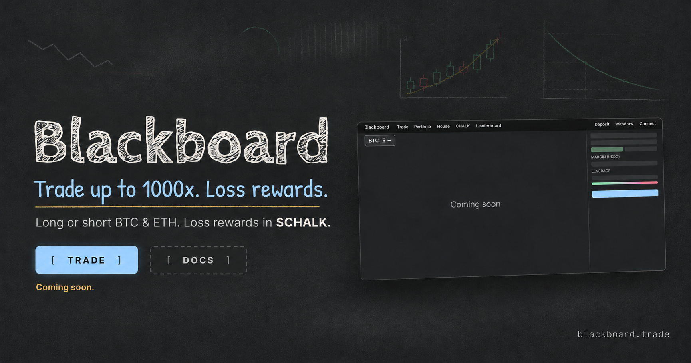

<div align="center">

# Blackboard marketing skill

**Create product-accurate social content and Blackboard-native image concepts with Codex or ChatGPT.**

[Skill instructions](SKILL.md) · [Product mechanics](references/product-mechanics.md) · [Visual system](references/visual-system.md) · [Asset catalog](references/asset-catalog.md)

</div>



## What this skill does

This skill gives a marketing agent the product context, editorial rules, and visual source material needed to create Blackboard content without drifting away from the app.

| Capability | Included guidance |
| --- | --- |
| Social content | Platform-ready posts, threads, carousels, campaign ideas, and product explainers |
| Image direction | Blackboard-native prompts, layout notes, overlay copy, aspect ratios, and reusable source assets |
| Product accuracy | Long/short exposure, collateral, leverage, PnL, haircut, liquidation, House accounting, staking, and redemption |
| Market awareness | Crypto and US equity content with an explicit live-market verification gate |
| Brand consistency | Chalkboard palette, typography, spacing, component patterns, icons, token art, and existing social images |

The current bundled snapshot contains **52 frontend components, 17 stylesheets, and 22 visual assets**. It is reference material for content production, not a standalone application.

## Install

### Option 1: ask Codex to install it

Invoke `$skill-installer` in Codex and ask:

```text
Install the skill from https://github.com/Blackboard-Trading/blackboard-marketing-skill
```

Codex detects newly installed skills automatically. Restart Codex if it does not appear immediately.

### Option 2: install for one repository

Run this from the repository where the skill should be available:

```bash
mkdir -p .agents/skills/blackboard-marketing
curl -L https://github.com/Blackboard-Trading/blackboard-marketing-skill/archive/refs/heads/main.tar.gz \
  | tar -xz --strip-components=1 -C .agents/skills/blackboard-marketing
```

### Option 3: install for your user account

Use the same archive in your personal skills directory to make it available across repositories:

```bash
mkdir -p "$HOME/.agents/skills/blackboard-marketing"
curl -L https://github.com/Blackboard-Trading/blackboard-marketing-skill/archive/refs/heads/main.tar.gz \
  | tar -xz --strip-components=1 -C "$HOME/.agents/skills/blackboard-marketing"
```

These locations follow the [official OpenAI skill discovery guidance](https://learn.chatgpt.com/docs/build-skills#where-to-save-skills). The repository follows the open [Agent Skills](https://agentskills.io) format: `SKILL.md` is required; `references/` and `assets/` provide supporting context.

## Use

Invoke the skill explicitly in Codex:

```text
$blackboard-marketing

Write an X thread explaining how Blackboard's House and haircut mechanism work.
Audience: crypto-native traders. Keep it educational, not promotional.
Include a 4:5 image concept for the opening post.
```

Or ask naturally and let Codex select the skill when the request matches its description.

More example prompts:

```text
Create a five-slide carousel explaining staking decay and lock multipliers.
```

```text
Turn this release note into separate X and LinkedIn posts. Flag every claim that needs a live-data check.
```

```text
Create an image brief for a BTC long/short explainer using only bundled Blackboard visual references.
```

For the best result, include the platform, audience, objective, language, desired action, and any verified launch date or live product data.

## Accuracy by design

The skill is deliberately conservative around financial claims:

- Blackboard positions are price exposure; the copy must not imply ownership of the underlying asset or share.
- Prices, balances, yields, House values, and execution results are never invented or treated as zero when unavailable.
- Profit, token appreciation, redemption value, execution price, and uninterrupted availability are never guaranteed.
- Generated art may be illustrative, but factual charts, balances, interfaces, prices, and logos must come from verified sources or supplied assets.
- Market, chain, parameter, schedule, and deployment claims require a current environment check before publication.

> [!IMPORTANT]
> The bundled source snapshot has BTC markets in test/UAT configuration and BTC/ETH in a local fixture. It contains no configured US equity symbol. The skill can create US equity content, but it must not claim that US equity trading is live until the current deployment configuration, price source, trading path, session rules, and risk parameters confirm it.

## Repository map

```text
blackboard-marketing-skill/
├── SKILL.md                         # Workflow and non-negotiable rules
├── references/
│   ├── social-playbook.md           # Voice, platform adaptation, review checklist
│   ├── product-mechanics.md         # Product behavior and financial math
│   ├── visual-system.md             # Art direction and layout language
│   ├── asset-catalog.md             # Reusable asset index
│   └── source-sync.md               # Snapshot provenance and refresh procedure
└── assets/blackboard-frontend/
    ├── components/                  # Reusable frontend reference components
    ├── styles/                      # Design tokens and UI styles
    ├── assets/                      # Logos, token art, icons, and imagery
    └── public/                      # Social images and favicon
```

## Keep the skill current

The source branch, commit, reviewed mechanics, and copied paths are recorded in [`references/source-sync.md`](references/source-sync.md). When the app changes:

1. refresh the complete allowed frontend snapshot;
2. re-check network market lists and served deployment configuration;
3. re-check trading, staking, House, liquidation, and redemption behavior;
4. update the references and examples together; and
5. review the public diff for secrets and private operational data before publishing.

## Rights

This repository is public for convenient team access. No open-source license is granted for the copied Blackboard frontend, brand, social, or provider assets. Their ownership and third-party rights remain with their respective owners.
